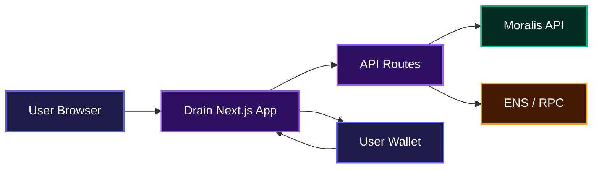
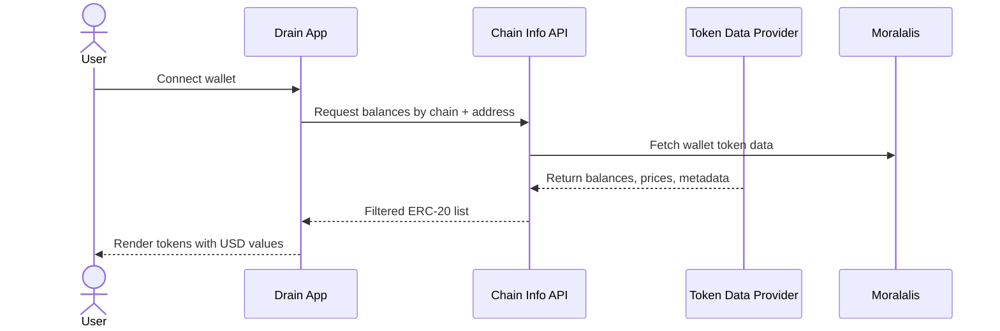
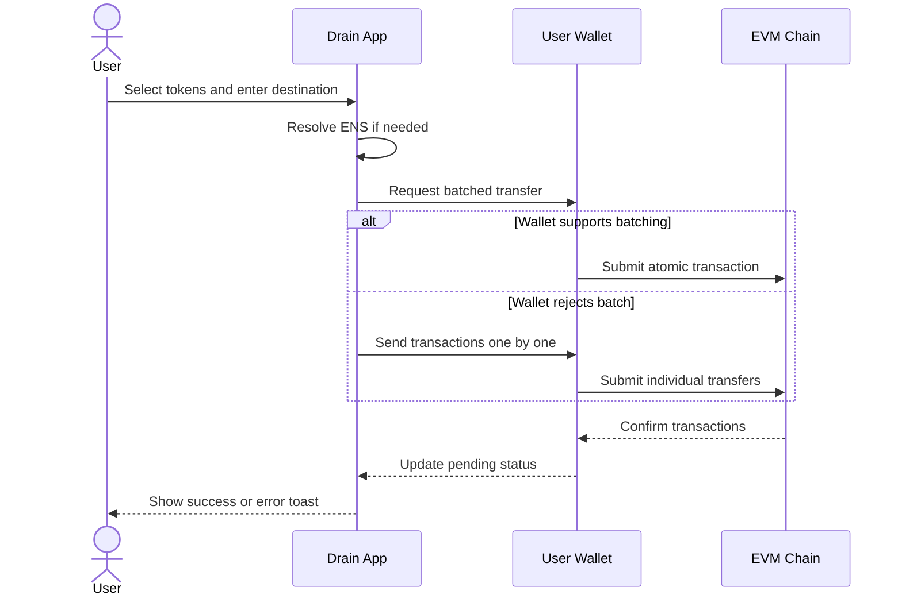
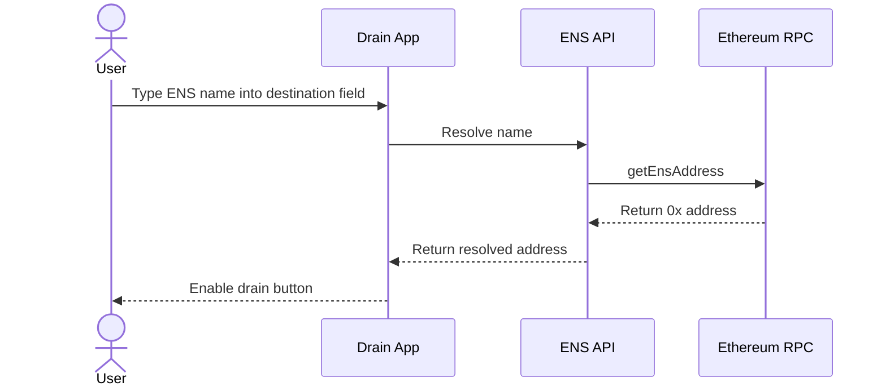

# Drain

⚠️ **LEGAL DISCLAIMER: This tool is for LEGITIMATE purposes only. Do NOT use for malicious activities, theft, or unauthorized access to wallets. Only use with wallets you own or have explicit permission to access.**

Open-source, non-custodial tool for rescuing and migrating assets from one EVM wallet to another.

## 🚨 **IMPORTANT WARNINGS**

- **ONLY use with wallets you OWN**
- **NEVER use for theft or unauthorized access**
- **Always verify destination addresses**
- **Test with small amounts first**
- **This tool is for legitimate purposes only**

## Overview

Drain helps people move every token they still control out of a compromised or outdated wallet and into a fresh one. It scans the connected wallet for native currency and ERC-20 balances, lets the user pick what to move, and then sends the assets to a destination address in as few signatures as possible. The wallet that is being drained always stays in control, so private keys and seed phrases are never shared with the app.



## Features

- **Multi-chain balance discovery** — Pulls native and ERC-20 balances across Ethereum, Polygon, Optimism, Arbitrum, Base, Avalanche, BSC, Gnosis, and Linea.
- **One-click token selection** — Select all tokens or pick individual ones; the UI shows USD values and live transaction status.
- **Batch-first transfers** — When the wallet supports EIP-5792 / EIP-7702, every selected transfer is batched into a single atomic transaction with one signature.
- **Sequential fallback** — If batching is not available, Drain falls back to one transaction per token, including native-token value transfers that reserve gas automatically.
- **ENS destination support** — Type `vitalik.eth` instead of a raw address and the app resolves it through Ethereum mainnet.
- **Compromised wallet rescue guide** — A dedicated public page walks users through how to prepare a safe destination, move assets, and retire the old wallet.

### Balance discovery flow



### Drain transfer flow



### ENS destination resolution



## Installation

- Clone the repository:

```bash
git clone https://github.com/dawsbot/drain.git
cd drain
```

- Install dependencies:

```bash
npm install
```

- Copy the example environment file:

```bash
cp .env.example .env.local
```

- Fill in the required environment variables in `.env.local`:

```bash
NEXT_PUBLIC_WALLET_CONNECT_PROJECT_ID=your_walletconnect_project_id
MORALIS_API_KEY=your_moralis_api_key
```

- Start the development server:

```bash
npm run dev
```

Open http://localhost:3000 to use the app locally.

## Usage

1. Connect the wallet that holds the tokens you want to move.
2. Wait for the token list to load; it shows the balance and estimated USD value for each asset.
3. Select the tokens you want to move, or click **Select all**.
4. Enter the destination address or an ENS name like `vitalik.eth`.
5. Click the drain button and approve the transaction(s) in your wallet.
6. Watch the pending state update as each transfer confirms.

The app also includes a rescue guide at `/compromised-wallet-rescue/` that explains how to safely create a new wallet, verify the destination, and retire a compromised address.

## API Documentation

### GET `/api/chain-info/[chainId]/[evmAddress]`

**Description**: Returns the ERC-20 token balances and metadata for a wallet on a supported EVM chain.

**Request**:

No body required. Pass the parameters in the URL:

```bash
GET /api/chain-info/1/0x47ac0Fb4F2D84898e4D9E7b4DaB3C24507a6D503
```

**Response**:

```json
{
  "success": true,
  "data": {
    "erc20s": [
      {
        "contract_decimals": 6,
        "contract_name": "USD Coin",
        "contract_ticker_symbol": "USDC",
        "contract_address": "0xa0b86991c6218b36c1d19d4a2e9eb0ce3606eb48",
        "supports_erc": ["erc20"],
        "logo_url": "https://...",
        "last_transferred_at": "2024-01-01T00:00:00.000Z",
        "native_token": false,
        "type": "stablecoin",
        "balance": "1000000000",
        "balance_24h": "1000000000",
        "quote_rate": 1.0,
        "quote_rate_24h": 1.0,
        "quote": 1000.0,
        "quote_24h": 1000.0,
        "nft_data": null
      }
    ],
    "nfts": []
  }
}
```

**Errors**:

- `400`: The chain ID is not supported or the parameters failed validation.
- `500`: The Moralis API request failed or returned an unexpected response.

### GET `/api/ens/[name]`

**Description**: Resolves an ENS name to its Ethereum address using mainnet RPC endpoints.

**Request**:

No body required. Pass the ENS name in the URL:

```bash
GET /api/ens/vitalik.eth
```

**Response**:

```json
{
  "success": true,
  "address": "0xd8dA6BF26964aF9D7eEd9e03E53415D37aA96045"
}
```

**Errors**:

- `500`: ENS resolution failed, the name does not resolve, or the RPC request errored.

### Environment variables

| Variable | Required | Purpose |
|---|---|---|
| `NEXT_PUBLIC_WALLET_CONNECT_PROJECT_ID` | Yes | Project ID for WalletConnect / RainbowKit wallet connection. |
| `MORALIS_API_KEY` | Yes | API key used by the backend to fetch token balances and prices. |

## Technologies Used

| Technology | Link |
|---|---|
| TypeScript | https://www.typescriptlang.org/ |
| React | https://react.dev/ |
| Next.js | https://nextjs.org/ |
| Tailwind CSS | https://tailwindcss.com/ |
| Wagmi | https://wagmi.sh/ |
| RainbowKit | https://www.rainbowkit.com/ |
| Viem | https://viem.sh/ |
| Jotai | https://jotai.org/ |
| Moralis | https://moralis.io/ |
| Vitest | https://vitest.dev/ |
| Geist UI | https://geist-ui.dev/ |

## Contributing

Contributions are welcome. If you want to report a bug, suggest a feature, or open a pull request, please keep the project’s non-custodial security model in mind and avoid asking users for private keys or seed phrases. For more details, see the security guidelines in [SECURITY.md](./SECURITY.md).

## Author Info

- LinkedIn: https://linkedin.com/in/ugochukwu-nweze-08812a2b8
- X (Twitter): https://x.com/CodesNum80638

## Badges

[](https://www.typescriptlang.org/)
[](https://react.dev/)
[](https://nextjs.org/)
[](https://tailwindcss.com/)
[](https://wagmi.sh/)
[](https://vitest.dev/)
